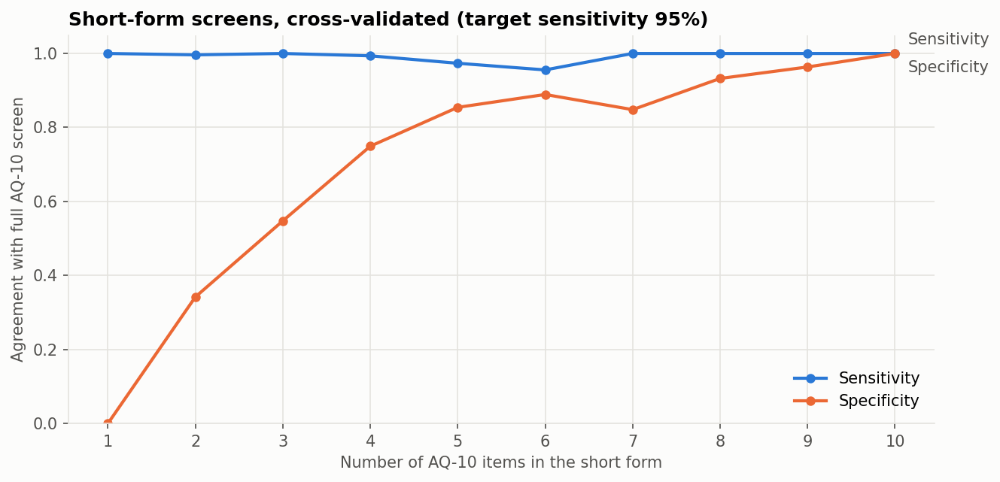

# AQ-10 Autism Screening Data: What Machine Learning Can and Can't Learn

A re-analysis of the UCI *Autism Screening Adult* dataset (704 AQ-10-Adult screening records from the ASDTests app, ages 17–64; 522 were self-completed, 87 were completed by a parent, relative, health care professional or other person, and 95 don't record who completed them). It finds that the dataset's ASD label **is** the questionnaire's scoring rule, so "predicting autism" from it is circular. It then asks two questions the data *can* answer: how short a screen can be without losing sensitivity, and whether background factors relate to a positive screen.

Reproduced by [`notebooks/aq10_screening_analysis.ipynb`](notebooks/aq10_screening_analysis.ipynb).

> The label is an **AQ-10 screening result, not a clinical diagnosis**. Nothing here is a diagnostic tool.

## 1. The label is the scoring rule

| AQ-10 score | 0–6 | 7–10 |
|---|---|---|
| Labelled ASD = NO | 515 | 0 |
| Labelled ASD = YES | 0 | 189 |

`Class/ASD` = YES exactly when the item sum is ≥ 7 (704 of 704 rows). A depth-2 decision tree on the score reaches 100% cross-validated accuracy. Any model trained on the ten items is relearning a sum and threshold, so the high accuracies commonly reported on this dataset aren't evidence of autism detection.

The earlier version of this project trained Decision Tree, Random Forest and XGBoost models (selected by accuracy) on a synthetic Kaggle derivative of this data. That approach has been replaced. See [Changes](#changes-from-the-earlier-version).

## 2. How short can the screen be?

The reference standard is the full AQ-10 decision. For each short-form length, items are ranked and a cutoff is chosen **inside each training fold** to reach ≥ 95% sensitivity, then applied unchanged to the held-out fold. Stratified 5-fold CV ×10 repeats (50 test folds).



| Items | Usual cutoff | Sensitivity | Specificity | PPV | NPV |
|---|---|---|---|---|---|
| 4 | ≥ 2 | 0.994 | 0.749 | 0.594 | 0.997 |
| **5** (items 3, 4, 5, 6, 9) | **≥ 3** | **0.974** | **0.854** | 0.712 | 0.989 |
| 6 | ≥ 4 | 0.956 | 0.889 | 0.769 | 0.983 |
| 8 | ≥ 5 | 1.000 | 0.932 | 0.846 | 1.000 |
| 10 (full AQ-10) | ≥ 7 | 1.000 | 1.000 | 1.000 | 1.000 |

## 3. Do background factors predict a positive screen?

Without any questionnaire items, logistic regression (class-weighted; preprocessing inside folds) reached:

| Features | Mean ROC-AUC (5-fold ×10) |
|---|---|
| Age, sex, jaundice, family history, prior app use, ethnicity | 0.728 |
| Same, without ethnicity | 0.618 |
| Ethnicity only | 0.705 |

Family history of autism (47.3% vs 23.8% screen-positive) and neonatal jaundice (40.6% vs 25.4%) were associated with higher screen-positive rates. **Most of the signal is ethnicity.** That most plausibly reflects who used the app and cultural differences in answering self-report items, a caution about AQ-10 fairness across groups rather than a usable predictor.

## Limitations

- **No diagnoses in the data**, so the AQ-10's own sensitivity and specificity against clinical assessment can't be estimated.
- **Self-selected app users** with a 26.8% screen-positive rate, far above population prevalence. PPV/NPV don't transfer to clinical settings.
- Short-form selection is cross-validated but **not externally validated**. Any short form would need testing against diagnostic assessment in a new sample.
- Small ethnicity subgroups (several under 20 people; 95 not reported). The same 95 records also lack who completed the test, so "not reported" marks a data-collection gap rather than an ethnic group. Treat its contribution to the ethnicity result with caution.
- **Not all records are self-reports by adults.** 87 were completed by someone else, and 18 respondents were aged 17, although the dataset is labelled "18 and more".

## Reproduce

```bash
python -m venv .venv
.venv\Scripts\activate            # macOS/Linux: source .venv/bin/activate
pip install -r requirements.txt
pytest
jupyter nbconvert --to notebook --execute --inplace notebooks/aq10_screening_analysis.ipynb
```

The UCI data (CC BY 4.0) is included in `data/raw/`, with provenance and checksum in [`data/README.md`](data/README.md). Tested with Python 3.13.

## Repository layout

```
data/raw/        UCI archive (CC BY 4.0) + data/README.md provenance
notebooks/       analysis notebook (executed)
reports/figures/ figures written by the notebook
src/aq10.py      loader, item ranking, sensitivity-targeted cutoffs, fold-wise short-form CV
tests/           pytest suite (metrics, cutoff selection, label rule, checksum)
```

## Changes from the earlier version

The earlier notebook:
- used a synthetic 800-row Kaggle file;
- couldn't run top to bottom (undefined variables, a committed `SyntaxError`, cells run out of order);
- swapped `Y_train`/`Y_test` in one split;
- used a row `ID` as a feature;
- fit encoders and SMOTE before cross-validation;
- selected models by accuracy while the README claimed recall was prioritized;
- described an 80/20 class split as "reflecting real-world prevalence" (adult autism prevalence is around 1–3%).

It has been replaced entirely.

## Data citation

Thabtah, F. (2017). *Autism Screening Adult* [Dataset]. UCI Machine Learning Repository. https://doi.org/10.24432/C5F019. Licensed CC BY 4.0.

## Author

Prince Kwarteng Amaning. MS Data Science, University of Michigan–Dearborn. Background in dentistry and public health.

License: MIT (code). Data: CC BY 4.0 (Thabtah, 2017).
